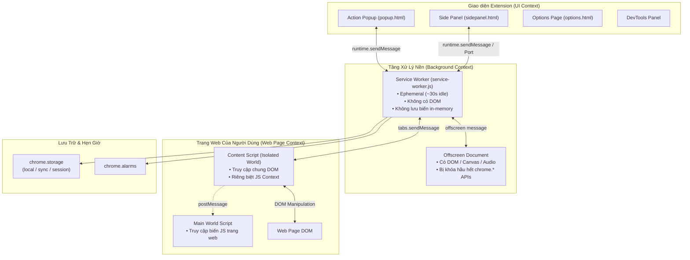

# Hướng Dẫn Cài Đặt & Cẩm Nang Phát Triển Chrome Extension (Manifest V3)

> **Tài liệu tham chiếu chuẩn hóa kiến trúc và quy trình phát triển Chrome Extension theo chuẩn Manifest V3.**  
> Tích hợp hướng dẫn cài đặt bộ skill chính thức từ [skills.sh (chrome-extensions)](https://www.skills.sh/googlechrome/modern-web-guidance/chrome-extensions), bộ skill kiểm toán bảo mật mã nguồn [skills.sh (security-review)](https://www.skills.sh/github/awesome-copilot/security-review), 20 nguyên tắc vàng sống còn, kiến trúc giao tiếp tin nhắn, tối ưu DOM, Prompt API (Built-in AI) và quy chuẩn xuất bản Chrome Web Store.

---

## PHẦN 1: HƯỚNG DẪN CÀI ĐẶT BỘ SKILL BẰNG COMMAND LINE VÀO LOCAL PROJECT

Bộ skill **`chrome-extensions`** thuộc gói công cụ chính thức **`GoogleChrome/modern-web-guidance`** (do Google Chrome, Microsoft Edge, Mozilla Firefox và MDN đồng bảo trợ).

Khi cài đặt vào **Local Project**, skill sẽ được cấu hình riêng biệt cho workspace hiện tại mà không ảnh hưởng đến các dự án khác trên máy.

### 1.1 Lệnh Cài Đặt Nhanh (1 Dòng Lệnh)

Mở terminal tại thư mục gốc của dự án (project root) và chạy:

```bash
npx skills add https://github.com/googlechrome/modern-web-guidance --skill chrome-extensions
```

Hoặc dùng cú pháp rút gọn qua GitHub identifier:

```bash
npx skills add googlechrome/modern-web-guidance --skill chrome-extensions
```

---

### 1.2 Các Tùy Chọn Cài Đặt Khuyên Dùng Cho Local Project

| Mục đích                                    | Câu lệnh thực thi                                                                     | Giải thích                                                                                                                                      |
| :------------------------------------------ | :------------------------------------------------------------------------------------ | :---------------------------------------------------------------------------------------------------------------------------------------------- |
| **Tự động hóa hoàn toàn (Non-interactive)** | `npx skills add googlechrome/modern-web-guidance --skill chrome-extensions -y`        | Bỏ qua mọi câu hỏi xác nhận (`--yes`), thích hợp cho script setup hoặc chạy tự động.                                                            |
| **Copy file trực tiếp (Khuyên dùng)**       | `npx skills add googlechrome/modern-web-guidance --skill chrome-extensions --copy -y` | Sao chép toàn bộ source `SKILL.md` và tài liệu tham khảo `references/` trực tiếp vào repo thay vì dùng symlink. Giúp project độc lập hoàn toàn. |
| **Cài đặt cho toàn bộ Agent trong project** | `npx skills add googlechrome/modern-web-guidance --skill chrome-extensions -a '*' -y` | Tự động liên kết skill đến tất cả các AI coding assistant được phát hiện trong project (Antigravity, Claude Code, Cursor, Codex...).            |

---

### 1.3 Phân Biệt Phạm Vi: Local Project vs Global

- **Mặc định (Local Project):** Khi chạy lệnh `npx skills add` bên trong thư mục dự án (không kèm cờ `-g`), công cụ sẽ tự động nhận diện và tạo cấu hình cục bộ:
  - Thư mục liên kết: `.agents/skills/chrome-extensions`, `.skills/chrome-extensions` hoặc `.gemini/skills/`.
  - File khóa phiên bản: `skills-lock.json` được tạo tại root project để đảm bảo cả nhóm làm việc cùng chung phiên bản skill.
- **Cài đặt Global (Toàn hệ thống):** Thêm cờ `-g` hoặc `--global` nếu muốn mọi dự án trên máy đều truy cập được:
  ```bash
  npx skills add googlechrome/modern-web-guidance --skill chrome-extensions -g -y
  ```

---

### 1.4 Kiểm Tra & Quản Lý Sau Khi Cài Đặt

- **Kiểm tra danh sách skill đã cài trong project:**
  ```bash
  npx skills list
  ```
- **Cập nhật skill lên phiên bản mới nhất:**
  ```bash
  npx skills update chrome-extensions
  ```
- **Gỡ bỏ skill khỏi project:**
  ```bash
  npx skills remove chrome-extensions -y
  ```

---

### 1.5 Phương Án Cài Đặt Dự Phòng (Native CLI từ Google Chrome)

Google Chrome cung cấp trình cài đặt tương tác chính thức:

```bash
npx modern-web-guidance@latest install
```

Lệnh này sẽ mở wizard chọn lựa các skill muốn tích hợp (bao gồm `chrome-extensions` và `modern-web-guidance`).

---

### 1.6 Hướng Dẫn Cài Đặt Skill Quét & Kiểm Toán Bảo Mật (`security-review`)

Bộ skill **`security-review`** từ kho [skills.sh - github/awesome-copilot/security-review](https://www.skills.sh/github/awesome-copilot/security-review) đóng vai trò như một chuyên gia bảo mật độc lập: phân tích luồng dữ liệu (Data Flow / Taint Analysis), phát hiện các lỗ hổng Injection (SQLi, XSS, Command Injection), kiểm tra lộ lọt bí mật (API Keys, Token, Hardcoded Secrets), phân quyền và các thư viện phụ thuộc có chứa mã độc.

#### 1. Lệnh cài đặt chính thức (Official Command)

Mở terminal tại thư mục gốc của dự án và chạy:

```bash
npx skills add https://github.com/github/awesome-copilot --skill security-review
```

Hoặc qua cú pháp định danh ngắn gọn:

```bash
npx skills add github/awesome-copilot --skill security-review
```

#### 2. Các tùy chọn cài đặt khuyên dùng cho Local Project

| Nhu cầu                                             | Câu lệnh thực thi                                                                | Giải thích                                                                                                                                              |
| :-------------------------------------------------- | :------------------------------------------------------------------------------- | :------------------------------------------------------------------------------------------------------------------------------------------------------ |
| **Cài đặt không cần prompt xác nhận**               | `npx skills add github/awesome-copilot --skill security-review -y`               | Thêm cờ `-y` (`--yes`) để tự động tải và cài đặt ngay.                                                                                                  |
| **Sao chép file vật lý (`--copy`)** _(Khuyên dùng)_ | `npx skills add github/awesome-copilot --skill security-review --copy -y`        | Copy toàn bộ mã nguồn `SKILL.md` và thư mục `references/` trực tiếp vào repo thay vì dùng symlink. Giúp dự án hoạt động độc lập và commit được vào Git. |
| **Kích hoạt cho tất cả AI Coding Agents**           | `npx skills add github/awesome-copilot --skill security-review -a '*' --copy -y` | Tự động cấu hình skill cho toàn bộ các Agent được phát hiện trong project (Antigravity, Claude Code, Cursor, Codex, Cline...).                          |

#### 3. Phân biệt phạm vi: Local Project vs Global

- **Cài đặt vào Local Project (Mặc định):**  
  Chạy lệnh tại thư mục dự án (không dùng cờ `-g`). Toàn bộ skill sẽ nằm cục bộ tại `.agents/skills/security-review/` của dự án đó mà không ảnh hưởng tới các project khác.
- **Cài đặt Global (Toàn hệ thống):**  
  Thêm cờ `-g` nếu muốn mọi dự án mở trên máy đều tự động nhận diện skill:
  ```bash
  npx skills add github/awesome-copilot --skill security-review -g -y
  ```

#### 4. Quản lý & kiểm tra sau khi cài đặt

- **Kiểm tra danh sách skill trong dự án:**
  ```bash
  npx skills list
  ```
- **Cập nhật lên bản mới nhất từ repo gốc:**
  ```bash
  npx skills update security-review
  ```
- **Gỡ cài đặt khỏi dự án:**
  ```bash
  npx skills remove security-review -y
  ```

#### 5. Cách kích hoạt sử dụng sau khi cài

- _"Quét mã nguồn dự án này để tìm lỗ hổng bảo mật"_
- _"Review security file service-worker.js và content.js"_
- _"Kiểm tra code có bị lộ hardcoded secret, token hay lỗi XSS/injection không"_
- Hoặc chạy slash command: `/security-review [đường_dẫn]`

---

## PHẦN 2: KIẾN TRÚC TỔNG QUAN CHROME EXTENSION (MANIFEST V3)

Manifest V3 (MV3) chuyển đổi toàn bộ tầng nền sang mô hình **Event-driven Service Worker** (không còn Background Page chạy ngầm liên tục), tăng cường bảo mật CSP và tách bạch quyền hạn.



### Bảng So Sánh Quyền Hạn & Vòng Đời

| Thành Phần         | Vòng Đời (Lifecycle)                                      |         Quyền Truy Cập DOM         |                     Quyền Gọi `chrome.*` API                      | Cơ Chế Giao Tiếp                                               |
| :----------------- | :-------------------------------------------------------- | :--------------------------------: | :---------------------------------------------------------------: | :------------------------------------------------------------- |
| **Service Worker** | **Tạm thời (Ephemeral)**, tự ngắt sau ~30s không có event |            ❌ **Không**            |                 ✅ **Đầy đủ** các API đã khai báo                 | `runtime.sendMessage`, `tabs.sendMessage`, `runtime.onConnect` |
| **Action Popup**   | Mở khi click icon, đóng ngay khi mất focus                |        ✅ Có DOM của popup         |                             ✅ Đầy đủ                             | `runtime.sendMessage` tới SW hoặc `tabs.sendMessage` tới tab   |
| **Side Panel**     | Mở cố định song song nội dung duyệt web                   |        ✅ Có DOM của panel         |                             ✅ Đầy đủ                             | `runtime.sendMessage`, gọi trực tiếp `tabs`/`storage`          |
| **Content Script** | Theo vòng đời của Tab trang web đích                      |   ✅ **Có** (DOM Isolated World)   |               ⚠️ **Hạn chế** (`runtime`, `storage`)               | Giao tiếp 2 chiều với SW qua `runtime.sendMessage`             |
| **Offscreen Doc**  | Do SW bật lên khi cần và tắt khi xong việc                | ✅ Có DOM, Audio, Canvas, Web APIs | ❌ **Bị khóa hầu hết** (Chỉ dùng `runtime.sendMessage/onMessage`) | Giao tiếp trung gian với SW qua `runtime.sendMessage`          |

---

## PHẦN 3: 20 NGUYÊN TẮC VÀNG BẮT BUỘC (MANDATORY RULES)

1. **Xử lý Icon:** Chỉ khai báo file ảnh thực sự tồn tại (`16×16`, `48×48`, `128×128`). Nếu chưa có file PNG chuẩn, **hãy xóa hoàn toàn** key `"icons"` và `"default_icon"` khỏi manifest.
2. **Side Panel Trigger:** Bắt buộc có trigger mở. Khuyên dùng: `chrome.sidePanel.setPanelBehavior({ openPanelOnActionClick: true })` trong Service Worker (chú ý: `openPanelOnActionClick`, không phải `openPanelOnActionIconClick`).
3. **CSP & Thực thi mã động:** Cấm tuyệt đối `eval()`, `new Function()`, inline script/listener. Nếu cần chạy mã động, bắt buộc dùng **Sandboxed Iframe** + `postMessage`.
4. **Quyền `tabs`:** Đọc `tab.url` hoặc `tab.title` bắt buộc phải khai báo `"permissions": ["tabs"]`, nếu không thuộc tính sẽ âm thầm trả về `undefined`.
5. **Bất đồng bộ:** Luôn dùng `async/await`, tuyệt đối không dùng chuỗi callback `.then()` lồng nhau.
6. **Tối ưu DOM trong Content Script:** Không làm nghẽn Main Thread; chia nhỏ thao tác DOM thành từng batch với `requestAnimationFrame` và `scheduler.yield()`.
7. **Service Worker Ephemeral:** SW tự terminate sau ~30 giây rảnh rỗi. Tuyệt đối không lưu state vào biến toàn cục. Phải lưu vào `chrome.storage.local/session` và dùng `chrome.alarms` thay cho `setInterval`.
8. **Cố định Extension ID (OAuth):** Thêm trường `"key"` vào manifest khi phát triển để cố định Extension ID khớp với Google Cloud OAuth Client ID.
9. **Context Menus:** Luôn tạo phản hồi thị giác (Badge text, Notification hoặc Toast) sau khi người dùng thực hiện thao tác qua chuột phải.
10. **Prompt API (Built-in AI):** Sử dụng trực tiếp `LanguageModel` trong mọi ngữ cảnh (SW, Popup, Side Panel) mà không cần cấp quyền đặc biệt.
11. **`chrome.action` API:** Bắt buộc phải có key `"action": {}` trong `manifest.json`.
12. **Giới hạn của `activeTab`:** Click button trong Side Panel **không kích hoạt** được `activeTab`. Phải dùng `"tabs"` + `"host_permissions"`.
13. **DevTools Panels:** Đường dẫn file HTML trong `chrome.devtools.panels.create()` phải tính tương đối từ **thư mục gốc (extension root)**.
14. **Offscreen Document:** Không có quyền gọi `chrome.downloads`, `chrome.action`. Chỉ làm việc với Web API và gửi kết quả về SW qua `runtime.sendMessage`.
15. **Ảnh trong Notification/Badge:** `notifications.create()` bắt buộc trỏ tới file ảnh thật hoặc Data URL từ `OffscreenCanvas`.
16. **Media Capture State Lock:** Phải có cơ chế khóa trạng thái (`idle` → `starting` → `recording` → `stopping`) để tránh lỗi crash do click đúp.
17. **`desktopCapture` từ SW:** Bắt buộc truyền đối tượng `targetTab` có chứa thuộc tính `url` (đòi hỏi quyền `"tabs"`).
18. **`chrome.userScripts`:** Kiểm tra `isUserScriptsAvailable()` trước khi gọi; cấu hình `configureWorld({ messaging: true })` và lưu cấu hình vào storage để re-register sau update.
19. **`chrome.windows`:** Không có phương thức `.query()`. Bắt buộc dùng `getAll`, `getLastFocused`, hoặc `getCurrent`.
20. **`permissions.request()` trong SW:** Phải gọi ngay lập tức trong nhịp đồng bộ đầu tiên của message listener, không được có bất kỳ lệnh `await` nào đứng trước làm mất User Gesture.

---

## PHẦN 4: GIAO TIẾP TIN NHẮN (MESSAGE PASSING)

### 4.1 Request - Response Chuẩn Mực (`return true`)

```javascript
// service-worker.js
chrome.runtime.onMessage.addListener((message, sender, sendResponse) => {
  if (message.type === "GET_DATA") {
    (async () => {
      try {
        const result = await chrome.storage.local.get("cache");
        sendResponse({ success: true, data: result.cache });
      } catch (err) {
        sendResponse({ success: false, error: err.message });
      }
    })();
    return true; // ⚠️ BẮT BUỘC: Giữ channel mở để sendResponse chạy async
  }
});
```

### 4.2 Cơ Chế Handshake (Chống Lỗi Tab Chưa Nạp Xong)

```javascript
// content.js - Báo danh khi vừa nạp xong
chrome.runtime.sendMessage({ type: "CONTENT_READY" });

// service-worker.js - Chỉ gửi lệnh khi nhận được tín hiệu sẵn sàng
chrome.runtime.onMessage.addListener((msg, sender) => {
  if (msg.type === "CONTENT_READY" && sender.tab?.id) {
    chrome.tabs.sendMessage(sender.tab.id, {
      type: "INIT_CONFIG",
      payload: { active: true },
    });
  }
});
```

---

## PHẦN 5: BẢO MẬT & XUẤT BẢN CHROME WEB STORE (CWS)

- **Tạo file `CHROMEWEBSTORE.md` tại root dự án:** Là nguồn dữ liệu duy nhất ghi lại thông tin mô tả, giải trình quyền hạn và chính sách bảo mật.
- **Quy tắc viết mô tả:** Chỉ nêu **Lợi ích người dùng (User Benefit)**, tuyệt đối không nhắc đến **Chi tiết lập trình (Implementation Details)** như MutationObserver, Service Worker, Shadow DOM...
- **Giải trình quyền hạn (Permissions Justification):** Viết rõ từng quyền phục vụ tính năng gì cụ thể cho người dùng (tránh viết chung chung "needed for extension to work" - sẽ bị từ chối duyệt ngay lập tức).
- **Đóng gói file ZIP:** Luôn loại bỏ `.git/`, `node_modules/`, `.vscode/`, `dist.zip` và các file tài liệu nội bộ trước khi nộp duyệt.
