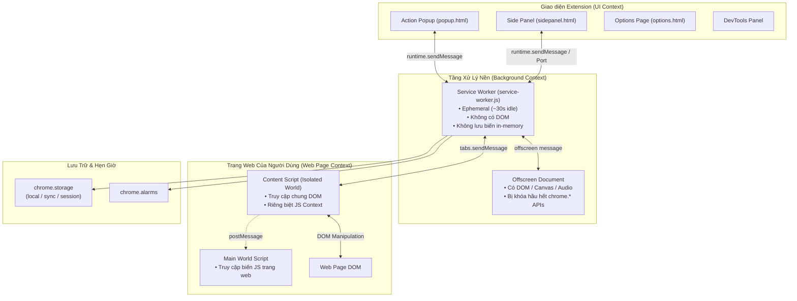

# Hướng Dẫn Cài Đặt & Cẩm Nang Phát Triển Chrome Extension (Manifest V3)

> **Tài liệu tham chiếu chuẩn hóa kiến trúc và quy trình phát triển Chrome Extension theo chuẩn Manifest V3.**  
> Tích hợp hướng dẫn cài đặt bộ skill chính thức từ [skills.sh (chrome-extensions)](https://www.skills.sh/googlechrome/modern-web-guidance/chrome-extensions), bộ skill kiểm toán bảo mật mã nguồn [skills.sh (security-review)](https://www.skills.sh/github/awesome-copilot/security-review), 20 nguyên tắc vàng sống còn, kiến trúc giao tiếp tin nhắn, chuyên đề tự động hóa mô phỏng hành vi người thật (Human-like Automation), Prompt API (Built-in AI) và quy chuẩn xuất bản Chrome Web Store.

---

## PHẦN 1: HƯỚNG DẪN CÀI ĐẶT BỘ SKILL BẰNG COMMAND LINE VÀO LOCAL PROJECT

Bộ skill **`chrome-extensions`** thuộc gói công cụ chính thức **`GoogleChrome/modern-web-guidance`** (do Google Chrome, Microsoft Edge, Mozilla Firefox và MDN đồng bảo trợ).

Khi cài đặt vào **Local Project**, skill sẽ được cấu hình riêng biệt cho workspace hiện tại mà không ảnh hưởng đến các dự án khác trên máy.

### 1.1 Lệnh Cài Đặt Nhanh (1 Dòng Lệnh)

Mở terminal tại thư mục gốc của dự án (project root) và chạy:

```bash
npx skills add https://github.com/googlechrome/modern-web-guidance --skill chrome-extensions
```

Hoặc dùng cú pháp rút gọn qua GitHub identifier:

```bash
npx skills add googlechrome/modern-web-guidance --skill chrome-extensions
```

---

### 1.2 Các Tùy Chọn Cài Đặt Khuyên Dùng Cho Local Project

| Mục đích                                    | Câu lệnh thực thi                                                                     | Giải thích                                                                                                                                      |
| :------------------------------------------ | :------------------------------------------------------------------------------------ | :---------------------------------------------------------------------------------------------------------------------------------------------- |
| **Tự động hóa hoàn toàn (Non-interactive)** | `npx skills add googlechrome/modern-web-guidance --skill chrome-extensions -y`        | Bỏ qua mọi câu hỏi xác nhận (`--yes`), thích hợp cho script setup hoặc chạy tự động.                                                            |
| **Copy file trực tiếp (Khuyên dùng)**       | `npx skills add googlechrome/modern-web-guidance --skill chrome-extensions --copy -y` | Sao chép toàn bộ source `SKILL.md` và tài liệu tham khảo `references/` trực tiếp vào repo thay vì dùng symlink. Giúp project độc lập hoàn toàn. |
| **Cài đặt cho toàn bộ Agent trong project** | `npx skills add googlechrome/modern-web-guidance --skill chrome-extensions -a '*' -y` | Tự động liên kết skill đến tất cả các AI coding assistant được phát hiện trong project (Antigravity, Claude Code, Cursor, Codex...).            |

---

### 1.3 Phân Biệt Phạm Vi: Local Project vs Global

- **Mặc định (Local Project):** Khi chạy lệnh `npx skills add` bên trong thư mục dự án (không kèm cờ `-g`), công cụ sẽ tự động nhận diện và tạo cấu hình cục bộ:
  - Thư mục liên kết: `.agents/skills/chrome-extensions`, `.skills/chrome-extensions` hoặc `.gemini/skills/`.
  - File khóa phiên bản: `skills-lock.json` được tạo tại root project để đảm bảo cả nhóm làm việc cùng chung phiên bản skill.
- **Cài đặt Global (Toàn hệ thống):** Thêm cờ `-g` hoặc `--global` nếu muốn mọi dự án trên máy đều truy cập được:
  ```bash
  npx skills add googlechrome/modern-web-guidance --skill chrome-extensions -g -y
  ```

---

### 1.4 Kiểm Tra & Quản Lý Sau Khi Cài Đặt

- **Kiểm tra danh sách skill đã cài trong project:**
  ```bash
  npx skills list
  ```
- **Cập nhật skill lên phiên bản mới nhất:**
  ```bash
  npx skills update chrome-extensions
  ```
- **Gỡ bỏ skill khỏi project:**
  ```bash
  npx skills remove chrome-extensions -y
  ```

---

### 1.5 Phương Án Cài Đặt Dự Phòng (Native CLI từ Google Chrome)

Google Chrome cung cấp trình cài đặt tương tác chính thức:

```bash
npx modern-web-guidance@latest install
```

Lệnh này sẽ mở wizard chọn lựa các skill muốn tích hợp (bao gồm `chrome-extensions` và `modern-web-guidance`).

---

### 1.6 Hướng Dẫn Cài Đặt Skill Quét & Kiểm Toán Bảo Mật (`security-review`)

Bộ skill **`security-review`** từ kho [skills.sh - github/awesome-copilot/security-review](https://www.skills.sh/github/awesome-copilot/security-review) đóng vai trò như một chuyên gia bảo mật độc lập: phân tích luồng dữ liệu (Data Flow / Taint Analysis), phát hiện các lỗ hổng Injection (SQLi, XSS, Command Injection), kiểm tra lộ lọt bí mật (API Keys, Token, Hardcoded Secrets), phân quyền và các thư viện phụ thuộc có chứa mã độc.

#### 1. Lệnh cài đặt chính thức (Official Command)

Mở terminal tại thư mục gốc của dự án và chạy:

```bash
npx skills add https://github.com/github/awesome-copilot --skill security-review
```

Hoặc qua cú pháp định danh ngắn gọn:

```bash
npx skills add github/awesome-copilot --skill security-review
```

#### 2. Các tùy chọn cài đặt khuyên dùng cho Local Project

| Nhu cầu                                             | Câu lệnh thực thi                                                                | Giải thích                                                                                                                                              |
| :-------------------------------------------------- | :------------------------------------------------------------------------------- | :------------------------------------------------------------------------------------------------------------------------------------------------------ |
| **Cài đặt không cần prompt xác nhận**               | `npx skills add github/awesome-copilot --skill security-review -y`               | Thêm cờ `-y` (`--yes`) để tự động tải và cài đặt ngay.                                                                                                  |
| **Sao chép file vật lý (`--copy`)** _(Khuyên dùng)_ | `npx skills add github/awesome-copilot --skill security-review --copy -y`        | Copy toàn bộ mã nguồn `SKILL.md` và thư mục `references/` trực tiếp vào repo thay vì dùng symlink. Giúp dự án hoạt động độc lập và commit được vào Git. |
| **Kích hoạt cho tất cả AI Coding Agents**           | `npx skills add github/awesome-copilot --skill security-review -a '*' --copy -y` | Tự động cấu hình skill cho toàn bộ các Agent được phát hiện trong project (Antigravity, Claude Code, Cursor, Codex, Cline...).                          |

#### 3. Phân biệt phạm vi: Local Project vs Global

- **Cài đặt vào Local Project (Mặc định):**  
  Chạy lệnh tại thư mục dự án (không dùng cờ `-g`). Toàn bộ skill sẽ nằm cục bộ tại `.agents/skills/security-review/` của dự án đó mà không ảnh hưởng tới các project khác.
- **Cài đặt Global (Toàn hệ thống):**  
  Thêm cờ `-g` nếu muốn mọi dự án mở trên máy đều tự động nhận diện skill:
  ```bash
  npx skills add github/awesome-copilot --skill security-review -g -y
  ```

#### 4. Quản lý & kiểm tra sau khi cài đặt

- **Kiểm tra danh sách skill trong dự án:**
  ```bash
  npx skills list
  ```
- **Cập nhật lên bản mới nhất từ repo gốc:**
  ```bash
  npx skills update security-review
  ```
- **Gỡ cài đặt khỏi dự án:**
  ```bash
  npx skills remove security-review -y
  ```

#### 5. Cách kích hoạt sử dụng sau khi cài

- _"Quét mã nguồn dự án này để tìm lỗ hổng bảo mật"_
- _"Review security file service-worker.js và content.js"_
- _"Kiểm tra code có bị lộ hardcoded secret, token hay lỗi XSS/injection không"_
- Hoặc chạy slash command: `/security-review [đường_dẫn]`

---

## PHẦN 2: KIẾN TRÚC TỔNG QUAN CHROME EXTENSION (MANIFEST V3)

Manifest V3 (MV3) chuyển đổi toàn bộ tầng nền sang mô hình **Event-driven Service Worker** (không còn Background Page chạy ngầm liên tục), tăng cường bảo mật CSP và tách bạch quyền hạn.



### Bảng So Sánh Quyền Hạn & Vòng Đời

| Thành Phần         | Vòng Đời (Lifecycle)                                      |         Quyền Truy Cập DOM         |                     Quyền Gọi `chrome.*` API                      | Cơ Chế Giao Tiếp                                               |
| :----------------- | :-------------------------------------------------------- | :--------------------------------: | :---------------------------------------------------------------: | :------------------------------------------------------------- |
| **Service Worker** | **Tạm thời (Ephemeral)**, tự ngắt sau ~30s không có event |            ❌ **Không**            |                 ✅ **Đầy đủ** các API đã khai báo                 | `runtime.sendMessage`, `tabs.sendMessage`, `runtime.onConnect` |
| **Action Popup**   | Mở khi click icon, đóng ngay khi mất focus                |        ✅ Có DOM của popup         |                             ✅ Đầy đủ                             | `runtime.sendMessage` tới SW hoặc `tabs.sendMessage` tới tab   |
| **Side Panel**     | Mở cố định song song nội dung duyệt web                   |        ✅ Có DOM của panel         |                             ✅ Đầy đủ                             | `runtime.sendMessage`, gọi trực tiếp `tabs`/`storage`          |
| **Content Script** | Theo vòng đời của Tab trang web đích                      |   ✅ **Có** (DOM Isolated World)   |               ⚠️ **Hạn chế** (`runtime`, `storage`)               | Giao tiếp 2 chiều với SW qua `runtime.sendMessage`             |
| **Offscreen Doc**  | Do SW bật lên khi cần và tắt khi xong việc                | ✅ Có DOM, Audio, Canvas, Web APIs | ❌ **Bị khóa hầu hết** (Chỉ dùng `runtime.sendMessage/onMessage`) | Giao tiếp trung gian với SW qua `runtime.sendMessage`          |

---

## PHẦN 3: 20 NGUYÊN TẮC VÀNG BẮT BUỘC (MANDATORY RULES)

1. **Xử lý Icon:** Chỉ khai báo file ảnh thực sự tồn tại (`16×16`, `48×48`, `128×128`). Nếu chưa có file PNG chuẩn, **hãy xóa hoàn toàn** key `"icons"` và `"default_icon"` khỏi manifest.
2. **Side Panel Trigger:** Bắt buộc có trigger mở. Khuyên dùng: `chrome.sidePanel.setPanelBehavior({ openPanelOnActionClick: true })` trong Service Worker (chú ý: `openPanelOnActionClick`, không phải `openPanelOnActionIconClick`).
3. **CSP & Thực thi mã động:** Cấm tuyệt đối `eval()`, `new Function()`, inline script/listener. Nếu cần chạy mã động, bắt buộc dùng **Sandboxed Iframe** + `postMessage`.
4. **Quyền `tabs`:** Đọc `tab.url` hoặc `tab.title` bắt buộc phải khai báo `"permissions": ["tabs"]`, nếu không thuộc tính sẽ âm thầm trả về `undefined`.
5. **Bất đồng bộ:** Luôn dùng `async/await`, tuyệt đối không dùng chuỗi callback `.then()` lồng nhau.
6. **Tối ưu DOM trong Content Script:** Không làm nghẽn Main Thread; chia nhỏ thao tác DOM thành từng batch với `requestAnimationFrame` và `scheduler.yield()`.
7. **Service Worker Ephemeral:** SW tự terminate sau ~30 giây rảnh rỗi. Tuyệt đối không lưu state vào biến toàn cục. Phải lưu vào `chrome.storage.local/session` và dùng `chrome.alarms` thay cho `setInterval`.
8. **Cố định Extension ID (OAuth):** Thêm trường `"key"` vào manifest khi phát triển để cố định Extension ID khớp với Google Cloud OAuth Client ID.
9. **Context Menus:** Luôn tạo phản hồi thị giác (Badge text, Notification hoặc Toast) sau khi người dùng thực hiện thao tác qua chuột phải.
10. **Prompt API (Built-in AI):** Sử dụng trực tiếp `LanguageModel` trong mọi ngữ cảnh (SW, Popup, Side Panel) mà không cần cấp quyền đặc biệt.
11. **`chrome.action` API:** Bắt buộc phải có key `"action": {}` trong `manifest.json`.
12. **Giới hạn của `activeTab`:** Click button trong Side Panel **không kích hoạt** được `activeTab`. Phải dùng `"tabs"` + `"host_permissions"`.
13. **DevTools Panels:** Đường dẫn file HTML trong `chrome.devtools.panels.create()` phải tính tương đối từ **thư mục gốc (extension root)**.
14. **Offscreen Document:** Không có quyền gọi `chrome.downloads`, `chrome.action`. Chỉ làm việc với Web API và gửi kết quả về SW qua `runtime.sendMessage`.
15. **Ảnh trong Notification/Badge:** `notifications.create()` bắt buộc trỏ tới file ảnh thật hoặc Data URL từ `OffscreenCanvas`.
16. **Media Capture State Lock:** Phải có cơ chế khóa trạng thái (`idle` → `starting` → `recording` → `stopping`) để tránh lỗi crash do click đúp.
17. **`desktopCapture` từ SW:** Bắt buộc truyền đối tượng `targetTab` có chứa thuộc tính `url` (đòi hỏi quyền `"tabs"`).
18. **`chrome.userScripts`:** Kiểm tra `isUserScriptsAvailable()` trước khi gọi; cấu hình `configureWorld({ messaging: true })` và lưu cấu hình vào storage để re-register sau update.
19. **`chrome.windows`:** Không có phương thức `.query()`. Bắt buộc dùng `getAll`, `getLastFocused`, hoặc `getCurrent`.
20. **`permissions.request()` trong SW:** Phải gọi ngay lập tức trong nhịp đồng bộ đầu tiên của message listener, không được có bất kỳ lệnh `await` nào đứng trước làm mất User Gesture.

---

## PHẦN 4: GIAO TIẾP TIN NHẮN (MESSAGE PASSING)

### 4.1 Request - Response Chuẩn Mực (`return true`)

```javascript
// service-worker.js
chrome.runtime.onMessage.addListener((message, sender, sendResponse) => {
  if (message.type === "GET_DATA") {
    (async () => {
      try {
        const result = await chrome.storage.local.get("cache");
        sendResponse({ success: true, data: result.cache });
      } catch (err) {
        sendResponse({ success: false, error: err.message });
      }
    })();
    return true; // ⚠️ BẮT BUỘC: Giữ channel mở để sendResponse chạy async
  }
});
```

### 4.2 Cơ Chế Handshake (Chống Lỗi Tab Chưa Nạp Xong)

```javascript
// content.js - Báo danh khi vừa nạp xong
chrome.runtime.sendMessage({ type: "CONTENT_READY" });

// service-worker.js - Chỉ gửi lệnh khi nhận được tín hiệu sẵn sàng
chrome.runtime.onMessage.addListener((msg, sender) => {
  if (msg.type === "CONTENT_READY" && sender.tab?.id) {
    chrome.tabs.sendMessage(sender.tab.id, {
      type: "INIT_CONFIG",
      payload: { active: true },
    });
  }
});
```

---

## PHẦN 5: CHUYÊN ĐỀ TỰ ĐỘNG HÓA & MÔ PHỎNG HÀNH VI NGƯỜI THẬT (HUMAN-LIKE WEB AUTOMATION)

> ⚡ **HƯỚNG DẪN KÍCH HOẠT DÀNH CHO AI & DEVELOPER:**  
> Áp dụng toàn bộ kiến trúc và các thuật toán trong phần này **khi người dùng yêu cầu tạo công cụ tự động hóa các xử lý trên trang web** (Web Automation, Auto Clicker, Auto Scroll, Điền Form Tự Động, Cào Dữ Liệu Tự Động, Bot hỗ trợ thao tác lặp lại...).  
> Mục tiêu cốt lõi: **Thao tác mượt mà, tự nhiên, sinh ra sự kiện `isTrusted` hợp lệ và không bị hệ thống phòng thủ phát hiện hành vi máy móc.**

---

### 5.1 Bản Chất Kỹ Thuật: 3 Lớp Phát Hiện Automation Trên Web

Các website hiện đại phát hiện công cụ tự động thông qua 3 lớp phòng vệ:

| Lớp Kiểm Soát | Dấu Hiệu Nhận Diện Bot | Giải Pháp Chuẩn Hóa |
| :--- | :--- | :--- |
| **1. Thuộc tính Event** | `event.isTrusted === false` khi gọi `element.click()` hoặc `dispatchEvent(...)` từ Content Script. | Sử dụng **`chrome.debugger`** (Chrome DevTools Protocol - CDP) với phương thức `Input.dispatchMouseEvent` để tạo sự kiện Trusted 100% từ tầng trình duyệt. |
| **2. Dấu vết Hành vi (Behavioral Biometrics)** | Con trỏ dịch chuyển tức thời (teleport), click chính xác 100% vào tâm phần tử, nhịp click đều đặn cố định (`setInterval`), cuộn trang nhảy cóc. | Mô phỏng **quỹ đạo cong Bézier**, phân phối ngẫu nhiên **Gaussian & Log-normal**, click lệch tâm và cuộn mượt có quán tính. |
| **3. Môi trường Thực thi** | Biến `navigator.webdriver = true`, kích thước viewport lạ, cờ Headless. | Extension chạy trực tiếp trên phiên bản Google Chrome thật của người dùng nên vượt qua hoàn toàn lớp kiểm tra môi trường này. |

> [!NOTE]
> Khi sử dụng `chrome.debugger` để sinh sự kiện Trusted, Chrome sẽ hiển thị một thanh thông báo vàng trên đầu trình duyệt: *'Extension đang debug trình duyệt này'*. Đây là cơ chế bảo mật cốt lõi của nền tảng Chrome và không thể tắt bằng code chính thống.

---

### 5.2 Cấu Trúc Module Dự Án Tự Động Hóa Chuẩn Mực

```
my-automation-extension/
├── manifest.json              # Khai báo quyền debugger và permissions
├── background/
│   └── service-worker.js      # Điều phối CDP (chrome.debugger), điều hướng SPA
└── content/
    ├── content.js             # Đọc DOM, tính tọa độ phần tử, lắng nghe trạng thái trang
    └── human.js               # Thuật toán: Gaussian, Log-normal, Bézier, Settle, Scroll
```

#### Mẫu `manifest.json` Chuyên Dụng Tự Động Hóa:
```json
{
  "manifest_version": 3,
  "name": "Human-like Web Automation Assistant",
  "version": "1.0.0",
  "permissions": [
    "debugger",
    "activeTab",
    "scripting",
    "webNavigation"
  ],
  "background": {
    "service_worker": "background/service-worker.js"
  },
  "content_scripts": [{
    "matches": ["https://*.example.com/*"],
    "js": ["content/human.js", "content/content.js"],
    "run_at": "document_idle"
  }]
}
```
*(Khuyên dùng: Luôn giới hạn `matches` ở đúng domain cần xử lý, tránh dùng `<all_urls>` để hạn chế bị Chrome Web Store rà soát).*

---

### 5.3 Module Thuật Toán Mô Phỏng Người Thật (`human.js`)

Module này chứa toàn bộ các hàm toán học mô phỏng tính ngẫu nhiên của con người:

```javascript
// content/human.js

// 1. Hàm sinh số ngẫu nhiên trong khoảng [min, max]
const rand = (min, max) => Math.random() * (max - min) + min;
const sleep = ms => new Promise(r => setTimeout(r, ms));
const clamp = (v, lo, hi) => Math.min(hi, Math.max(lo, v));

// 2. Phân phối chuẩn Gauss (Gaussian Distribution) - Đa số giá trị tập trung quanh Mean
function gaussian(mean, sd) {
  let u = 0, v = 0;
  while (!u) u = Math.random();
  while (!v) v = Math.random();
  return mean + sd * Math.sqrt(-2 * Math.log(u)) * Math.cos(2 * Math.PI * v);
}

// Độ trễ tự nhiên giữa 2 thao tác (mặc định trung bình 600ms, độ lệch 200ms)
const humanDelay = (mean = 600, sd = 200) => sleep(Math.max(80, gaussian(mean, sd)));

// 3. Phân phối Log-normal: Mô tả thời gian phản xạ của người thật (lệch phải, đôi khi bị phân tâm rất lâu)
function logNormal(median, sigma = 0.45) {
  const g = gaussian(0, 1);
  return median * Math.exp(sigma * g);
}

// 4. Tạo quỹ đạo chuột bằng đường cong Bézier bậc 3 có gia tốc easing và rung nhiễu vi sai
function bezierPath(from, to, steps = 35) {
  const dx = to.x - from.x;
  const dy = to.y - from.y;
  const dist = Math.hypot(dx, dy);

  // 2 điểm điều khiển (Control Points) lệch ngẫu nhiên khỏi đường thẳng
  const offset = dist * rand(0.12, 0.28) * (Math.random() < 0.5 ? -1 : 1);
  const c1 = { 
    x: from.x + dx * 0.3 - (dy / dist) * offset, 
    y: from.y + dy * 0.3 + (dx / dist) * offset 
  };
  const c2 = { 
    x: from.x + dx * 0.7 + (dy / dist) * offset * 0.5, 
    y: from.y + dy * 0.7 - (dx / dist) * offset * 0.5 
  };

  // Easing in-out: chậm lúc bắt đầu, nhanh ở giữa, chậm lại khi đến đích
  const ease = t => (t < 0.5 ? 2 * t * t : 1 - Math.pow(-2 * t + 2, 2) / 2);

  return Array.from({ length: steps + 1 }, (_, i) => {
    const t = ease(i / steps);
    const m = 1 - t;
    return {
      x: m**3 * from.x + 3 * m**2 * t * c1.x + 3 * m * t**2 * c2.x + t**3 * to.x + rand(-0.5, 0.5),
      y: m**3 * from.y + 3 * m**2 * t * c1.y + 3 * m * t**2 * c2.y + t**3 * to.y + rand(-0.5, 0.5)
    };
  });
}

// 5. Tính điểm click lệch tâm tự nhiên (Không bao giờ click chính giữa tâm phần tử)
function clickPoint(el) {
  const r = el.getBoundingClientRect();
  return {
    x: r.left + r.width  * Math.min(0.85, Math.max(0.15, gaussian(0.5, 0.15))),
    y: r.top  + r.height * Math.min(0.85, Math.max(0.15, gaussian(0.5, 0.15)))
  };
}
```

---

### 5.4 Điều Phối Sự Kiện Trusted Qua Chrome DevTools Protocol (`service-worker.js`)

Service worker nhận tọa độ từ content script và gửi lệnh qua `chrome.debugger` để sinh sự kiện chuột thật sự:

```javascript
// background/service-worker.js

// 1. Đính kèm Debugger vào Tab
async function attachDebugger(tabId) {
  try {
    await chrome.debugger.attach({ tabId }, "1.3");
  } catch (err) {
    if (!err.message.includes("Already attached")) throw err;
  }
}

const sendCdp = (tabId, method, params) => 
  chrome.debugger.sendCommand({ tabId }, method, params);

// 2. Thực thi Click chuột người thật theo quỹ đạo Bézier
async function humanClick(tabId, path) {
  await attachDebugger(tabId);

  // Di chuyển con trỏ chuột theo từng nấc của đường cong Bézier
  for (const point of path) {
    await sendCdp(tabId, "Input.dispatchMouseEvent", {
      type: "mouseMoved",
      x: Math.round(point.x),
      y: Math.round(point.y)
    });
    // Khoảng nghỉ giữa các frame di chuyển (8-22ms)
    await new Promise(r => setTimeout(r, rand(8, 22)));
  }

  const end = path[path.length - 1];
  
  // Dừng ngắn trước khi nhấn (người thật luôn có khoảnh khắc ngắm điểm click)
  await new Promise(r => setTimeout(r, rand(70, 220)));

  // Bấm chuột xuống
  await sendCdp(tabId, "Input.dispatchMouseEvent", {
    type: "mousePressed",
    x: Math.round(end.x),
    y: Math.round(end.y),
    button: "left",
    clickCount: 1
  });

  // Giữ chuột 50 - 130ms
  await new Promise(r => setTimeout(r, rand(50, 130)));

  // Nhả chuột
  await sendCdp(tabId, "Input.dispatchMouseEvent", {
    type: "mouseReleased",
    x: Math.round(end.x),
    y: Math.round(end.y),
    button: "left",
    clickCount: 1
  });
}

// 3. Cuộn trang có quán tính bánh xe chuột và 8% xác suất cuộn ngược nhẹ
async function humanScroll(tabId, totalPx, currentPoint) {
  await attachDebugger(tabId);
  let remaining = Math.abs(totalPx);
  const dir = Math.sign(totalPx);

  while (remaining > 0) {
    const burst = Math.min(remaining, rand(80, 250)); // 1 nấc lăn bánh xe
    const ticks = Math.ceil(burst / 40);

    for (let i = 0; i < ticks; i++) {
      const decay = 1 - i / ticks; // Quán tính chậm dần
      await sendCdp(tabId, "Input.dispatchMouseEvent", {
        type: "mouseWheel",
        x: Math.round(currentPoint.x),
        y: Math.round(currentPoint.y),
        deltaX: 0,
        deltaY: Math.round(dir * 40 * (0.5 + decay))
      });
      await new Promise(r => setTimeout(r, rand(16, 42)));
    }

    remaining -= burst;

    // Tạm dừng đọc nội dung (thỉnh thoảng dừng lâu hơn)
    await new Promise(r => setTimeout(r, Math.random() < 0.15 ? rand(1200, 2800) : rand(180, 550)));

    // 8% khả năng cuộn ngược nhẹ (người dùng cuộn lố và lùi lại)
    if (Math.random() < 0.08) {
      await sendCdp(tabId, "Input.dispatchMouseEvent", {
        type: "mouseWheel",
        x: Math.round(currentPoint.x),
        y: Math.round(currentPoint.y),
        deltaX: 0,
        deltaY: -dir * rand(30, 80)
      });
      await new Promise(r => setTimeout(r, rand(200, 600)));
    }
  }
}

// 4. Lắng nghe yêu cầu từ Content Script
chrome.runtime.onMessage.addListener((msg, sender, sendResponse) => {
  if (msg.type === "HUMAN_CLICK" && sender.tab?.id) {
    humanClick(sender.tab.id, msg.path).then(() => sendResponse({ ok: true }));
    return true;
  }
  if (msg.type === "HUMAN_SCROLL" && sender.tab?.id) {
    humanScroll(sender.tab.id, msg.totalPx, msg.point).then(() => sendResponse({ ok: true }));
    return true;
  }
});
```

---

### 5.5 Giai Đoạn "Nhìn - Quét - Đọc" Sau Khi Tải Trang (`settleAfterLoad`)

> **Quy tắc sống còn:** Người thật không bao giờ thao tác ngay khi trang web vừa tải xong. Họ cần thời gian để mắt nhận diện giao diện, đọc nội dung và quyết định hành động.

```javascript
// content/content.js

// 1. Chờ trang nạp hoàn tất
function waitForLoad() {
  return document.readyState === "complete"
    ? Promise.resolve()
    : new Promise(r => window.addEventListener("load", r, { once: true }));
}

// 2. Chờ DOM tĩnh lặng (không còn component JS nào render ngầm)
function waitForDomQuiet(quietMs = 400, timeoutMs = 8000) {
  return new Promise(resolve => {
    let timer = setTimeout(done, quietMs);
    const hardStop = setTimeout(done, timeoutMs);
    const observer = new MutationObserver(() => {
      clearTimeout(timer);
      timer = setTimeout(done, quietMs);
    });
    observer.observe(document.body, { childList: true, subtree: true, attributes: true });

    function done() {
      observer.disconnect();
      clearTimeout(timer);
      clearTimeout(hardStop);
      resolve();
    }
  });
}

// 3. Chờ Tab đang hiển thị ở Foreground (Tuyệt đối không chạy khi tab đang ở background)
function waitForVisible() {
  return document.visibilityState === "visible"
    ? Promise.resolve()
    : new Promise(r => {
        const handler = () => {
          if (document.visibilityState === "visible") {
            document.removeEventListener("visibilitychange", handler);
            r();
          }
        };
        document.addEventListener("visibilitychange", handler);
      });
}

// 4. Ước lượng thời gian "quét lướt" trang dựa trên số từ và ảnh trong Viewport
function estimateScanTime() {
  const vh = window.innerHeight;
  const elements = [...document.querySelectorAll("p, h1, h2, h3, li, a, button, span")]
    .filter(el => {
      const r = el.getBoundingClientRect();
      return r.bottom > 0 && r.top < vh;
    });

  const words = elements.map(el => el.innerText || "").join(" ").trim().split(/\s+/).filter(Boolean).length;
  const images = [...document.images].filter(i => {
    const r = i.getBoundingClientRect();
    return r.bottom > 0 && r.top < vh && r.width > 80;
  }).length;

  // Tốc độ quét lướt: 600 - 900ms cho mỗi 50 từ + 200 - 400ms cho mỗi hình ảnh
  const base = (words / 50) * rand(600, 900) + images * rand(200, 400);
  return clamp(base, 800, 9000);
}

// 5. Hàm điều phối chu kỳ ổn định trang toàn diện
async function settleAfterLoad({ firstVisit = true } = {}) {
  await waitForLoad();
  await waitForVisible();
  await waitForDomQuiet(400);

  // Giai đoạn nhìn lướt trang
  const scanTime = estimateScanTime();

  // Giai đoạn quyết định thao tác đầu tiên (Trang quen thuộc quyết định nhanh hơn trang mới)
  const decideTime = logNormal(firstVisit ? 1400 : 700, 0.45);

  // Tổng thời gian chờ tự nhiên: Dao động từ 1.5s đến 8s
  const totalWait = clamp(scanTime * rand(0.5, 0.8) + decideTime, 1500, 12000);
  await sleep(totalWait);

  // 6% xác suất người dùng bị phân tâm (uống nước, nhìn chỗ khác: chờ 4-10 giây)
  if (Math.random() < 0.06) {
    await sleep(rand(4000, 10000));
  }
}
```

---

### 5.6 Xử Lý Điều Hướng Trong Ứng Dụng SPA (Single Page Application)

Trong các trang web như YouTube, Facebook, X (Twitter), Gmail, việc chuyển trang diễn ra bằng History API chứ không reload lại trang. Service Worker cần thông báo cho Content Script chạy lại chu trình `settleAfterLoad`:

```javascript
// background/service-worker.js
chrome.webNavigation.onHistoryStateUpdated.addListener(details => {
  chrome.tabs.sendMessage(details.tabId, { type: "SPA_NAVIGATED", url: details.url });
});
```

```javascript
// content/content.js
let lastCursorPos = { x: 100, y: 100 };

async function onPageReady() {
  console.log("Trang mới nhận diện, đang chờ người thật quét nội dung...");
  await settleAfterLoad({ firstVisit: false });
  executeAutomatedWorkflow();
}

// Khởi chạy khi load trang lần đầu
onPageReady();

// Tái kích hoạt chu trình khi URL SPA thay đổi
chrome.runtime.onMessage.addListener(msg => {
  if (msg.type === "SPA_NAVIGATED") {
    onPageReady();
  }
});
```

---

### 5.7 Bảng Nguyên Tắc Vàng Khi Thiết Kế Tool Tự Động Hóa

1. **Tuyệt đối không dùng nhịp cố định:** Cấm `setInterval(fn, 3000)` hoặc `sleep(2000)` cố định. Luôn lấy mẫu từ phân phối ngẫu nhiên `gaussian` hoặc `logNormal`.
2. **Con trỏ chuột luôn xuất phát từ vị trí cũ:** Tuyệt đối không "teleport" chuột từ `(0, 0)` thẳng tới mục tiêu. Lưu `lastCursorPos` của thao tác trước làm điểm xuất phát cho thao tác tiếp theo.
3. **Cuộn trước khi click:** Phần tử bắt buộc phải được cuộn vào giữa viewport (`element.scrollIntoView({ behavior: 'smooth', block: 'center' })`) trước khi kích hoạt click.
4. **Giới hạn tốc độ tổng thể (Rate Limiting):** Yếu tố khiến bot bị đánh dấu nhiều nhất không phải là quỹ đạo chuột, mà là **số lượng thao tác mỗi giờ**. Hãy đặt giới hạn sinh học: không vượt quá 80 - 150 thao tác/giờ và luôn có các khoảng nghỉ dài (5 - 15 phút) giữa các phiên làm việc.

---

## PHẦN 6: BẢO MẬT & XUẤT BẢN CHROME WEB STORE (CWS)

- **Tạo file `CHROMEWEBSTORE.md` tại root dự án:** Là nguồn dữ liệu duy nhất ghi lại thông tin mô tả, giải trình quyền hạn và chính sách bảo mật.
- **Quy tắc viết mô tả:** Chỉ nêu **Lợi ích người dùng (User Benefit)**, tuyệt đối không nhắc đến **Chi tiết lập trình (Implementation Details)** như MutationObserver, Service Worker, Shadow DOM...
- **Giải trình quyền hạn (Permissions Justification):** Viết rõ từng quyền phục vụ tính năng gì cụ thể cho người dùng (tránh viết chung chung "needed for extension to work" - sẽ bị từ chối duyệt ngay lập tức).
- **Đóng gói file ZIP:** Luôn loại bỏ `.git/`, `node_modules/`, `.vscode/`, `dist.zip` và các file tài liệu nội bộ trước khi nộp duyệt.

